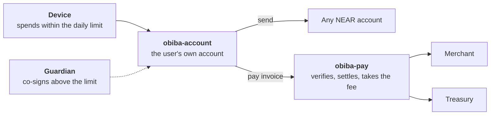
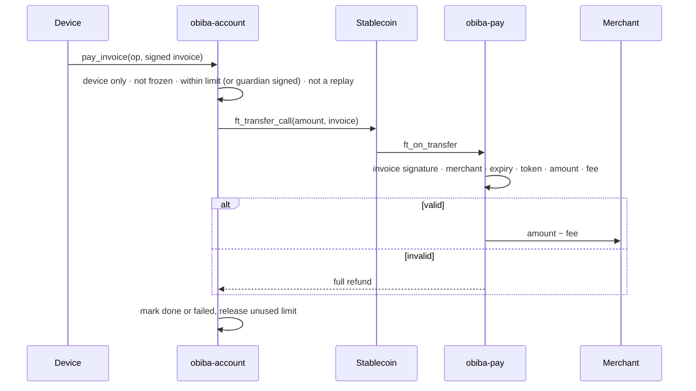

<h1 align="center">Obiba</h1>

<p align="center"><b>A bank account on NEAR that no bank controls.</b></p>

<p align="center">Self-custodial stablecoin accounts with the safety of a bank: daily limits, a guardian co-signer, 48-hour recovery and signed-invoice payments.<br/>Enforced by the contract. Not by us.</p>

<p align="center"><a href="#live-on-testnet">Live on testnet</a> · <a href="#how-it-works">How it works</a> · <a href="#run-it">Run it</a></p>

---

Crypto gives you custody but no safety net. Banks give you a safety net but take custody. **Obiba gives you both.** Your money sits in your own NEAR account, and the rules that protect it live on-chain, where nobody can switch them off. Not someone who breaks into our servers. Not even us.

|             **0**             |          **61 KB**          | **~0.009 NEAR** |          **159**          |
| :----------------------------------: | :-------------------------------: | :-------------------: | :-----------------------------: |
| full-access keys on any user account | one contract shared by every user | to open a new account | tests, 12 on a live local chain |

## How it works



|                                            |                                                                                                                           |
| ------------------------------------------ | ------------------------------------------------------------------------------------------------------------------------- |
| **Your device holds the only key**   | No full-access key exists. The device key can call one contract: the user's own account.                                  |
| **Spend freely, up to your limit**   | A rolling 24-hour limit, counted in dollars across every stablecoin.                                                      |
| **Big payments need two signatures** | Above the limit, the guardian must sign that exact payment. On its own, the guardian can't move a cent.                   |
| **Lose your device, not your money** | Recovery to a new device takes 48 hours, and any existing device can stop it.                                             |
| **Invoices that can't be gamed**     | `obiba-pay` settles only an exact match to an Obiba-signed invoice. Anything else bounces back in the same transaction. |
| **Every stablecoin, one limit**      | USDC today. New tokens go live without a redeploy.                                                                        |

## Built different

- **One contract, every user.** `obiba-account` is a NEAR global contract: deployed once, shared by every account, so a new user costs about 0.009 NEAR, a few cents.
- **No SDK, no bloat.** Both contracts are `no_std` Rust on a runtime we wrote ourselves. Builds are reproducible to the byte.
- **Nothing gets stuck.** Failed transfers give the limit back, failed merchant payouts are held and retryable, and stray tokens can always be moved out.
- **Changes happen in the open.** Fee, invoice key, treasury and token changes are public and wait 24 hours. The fee can never exceed 1%.

## Live on testnet

|                          |                                                                                                       |
| ------------------------ | ----------------------------------------------------------------------------------------------------- |
| Payments contract        | [`pay.obiba2.obiba-dev.testnet`](https://testnet.nearblocks.io/address/pay.obiba2.obiba-dev.testnet) |
| User accounts created by | `obiba2.obiba-dev.testnet`                                                                          |
| Account global code hash | `5Ma784uyf2QLxFhyGbnw5HfXvLEnoS45RWA5TrDSBKQm`                                                      |

## Run it

```bash
./build.sh                                                     # rustc 1.96.0 + wasm-opt 133
(cd mock-ft && cargo near build non-reproducible-wasm --no-abi)
cargo test --workspace -- --test-threads=2                    # 159 tests
```

---

## Reference

<details>
<summary><b>How a payment flows</b></summary>



</details>

<details>
<summary><b>obiba-account: rules</b></summary>

| Rule            | Value                                                                                    |
| --------------- | ---------------------------------------------------------------------------------------- |
| Daily limit     | Rolling 24 h, in 6-decimal USD, shared across tokens, rounded up                         |
| Per-payment cap | `max_op_amount`; refused even with the guardian                                        |
| Raise the limit | Guardian + 24 h delay, max 24 × `max_op_amount`                                       |
| Lower the limit | Device alone, immediate                                                                  |
| Payment expiry  | At most 1 h ahead                                                                        |
| Replay          | Every op has a unique 128-bit `op_id`                                                  |
| Devices         | Up to 5                                                                                  |
| Recovery        | 48 h timelock, any device can cancel                                                     |
| Freeze          | Up to 72 h, once per 7 days; lowering limits and removing access still work              |
| Guardian change | Immediate with the current guardian, or 7 days from the device alone (guardian can veto) |
| Tokens          | Up to 16; decimals fixed once registered; unregistered tokens need the guardian          |

</details>

<details>
<summary><b>obiba-account: methods</b></summary>

**Device** (its own function-call key):

| Method                                                   | Guardian?        |
| -------------------------------------------------------- | ---------------- |
| `execute(op, guardian_sig?)`                           | Above the limit  |
| `pay_invoice(op, invoice, guardian_sig?)`              | Above the limit  |
| `set_limit(new_limit, guardian_sig?, guardian_nonce?)` | To raise         |
| `add_device` / `remove_device`                       | Yes              |
| `add_token(token, decimals, …)`                       | Yes              |
| `disable_token(token)`                                 | No               |
| `unfreeze` / `rotate_guardian`                       | Yes              |
| `propose_guardian(new_guardian)`                       | No (7-day delay) |
| `cancel_recovery()`                                    | No               |

**Anyone can relay** (the guardian signature is the authorization): `begin_recovery`, `complete_recovery`, `freeze`, `veto_guardian_change`, `apply_guardian_change`.

**Views:** `get_policy()`, `get_op(op_id)`.

**Init** (only the parent account can call it):

```json
{
  "tokens": [{ "token": "usdc.near", "decimals": 6 }],
  "pay_contract": "pay.obiba.near",
  "network_id": "mainnet",
  "guardian": "ed25519:…",
  "device": "ed25519:…",
  "daily_limit": "100000000",
  "max_op_amount": "500000000"
}
```

USD amounts have 6 decimals (`100000000` = $100). A user account is created in one batch from the parent: create account, fund, deploy the global contract by hash, add the device's function-call key (`DEVICE_METHODS`, 0.25 NEAR allowance), call `new`.

</details>

<details>
<summary><b>obiba-pay: methods</b></summary>

**Payment:** `ft_on_transfer(sender_id, amount, msg)`, called by the token. `msg` is the signed invoice:

```json
{
  "invoice": {
    "invoice_id": "aa11bb22cc33dd44ee55ff6600778899",
    "merchant": "cafe.obiba.near",
    "token": "usdc.near",
    "amount": "12345678",
    "fee_bps": 50,
    "expires_at_ns": "1800003600000000000",
    "reference": "table-4"
  },
  "signature": "<base64 ed25519>"
}
```

Accepted only if not paused, token enabled, signature valid, merchant registered, not expired, not already paid, and token, amount and fee match exactly. The fee is capped at 1% (100 bps).

**Owner** (1 yoctoNEAR deposit):

| Immediate                                       | Public 24 h delay (`propose_*` → `apply_*`) |
| ----------------------------------------------- | ------------------------------------------------ |
| `pause` / `unpause`                         | fee                                              |
| `register_merchant` / `unregister_merchant` | invoice key                                      |
| `disable_token`                               | new token                                        |
| `withdraw_fees` (to the treasury only)        | treasury                                         |
| `propose_owner` → `accept_owner`           |                                                  |

**Anyone:** `apply_*` after the delay, `retry_owed(merchant, token)`, `prune(max)`.

**Views:** `get_config()`, `get_paid(invoice_id)`, `get_owed(merchant, token)`, `get_accrued_fees(token)`, `is_merchant(account)`.

**Init** (deploy and call in the same transaction):

```json
{
  "tokens": ["usdc.near"],
  "network_id": "mainnet",
  "owner": "obiba.near",
  "invoice_key": "ed25519:…",
  "fee_bps": 100,
  "treasury": "treasury.obiba.near"
}
```

</details>

<details>
<summary><b>Signed messages</b></summary>

ed25519 over sha256 of a Borsh preimage, domain-separated so a signature can't be reused for another purpose, account, contract or network.

| Message  | Preimage                                                   |
| -------- | ---------------------------------------------------------- |
| Guardian | `"obiba-account/v1"`, network, account, purpose, payload |
| Invoice  | `"obiba-invoice/v1"`, network, pay contract, invoice     |

Purposes: `ExecuteOp`, `RaiseLimit`, `AddDevice`, `RemoveDevice`, `BeginRecovery`, `Freeze`, `Unfreeze`, `RotateGuardian`, `VetoGuardianChange`, `AddToken`. Everything except `ExecuteOp` carries a `guardian_nonce` that must match and is then incremented.

[`test-vectors/vectors.json`](test-vectors/vectors.json) has a preimage, digest and signature for every message type, for off-chain signers to check against. Regenerate with `OBIBA_WRITE_VECTORS=1 cargo test -p obiba-common`.

</details>

<details>
<summary><b>Events</b></summary>

`EVENT_JSON:{"standard":"obiba","version":"1.0.0","event":"…","data":[…]}`

- **obiba-account:** `op_submitted`, `op_executed`, `op_failed`, `op_result_orphaned`, `limit_lowered`, `limit_raise_scheduled`, `device_added`, `device_removed`, `keys_change_reverted`, `recovery_started`, `recovery_cancelled`, `recovery_completed`, `frozen`, `unfrozen`, `guardian_rotated`, `guardian_change_proposed`, `guardian_change_vetoed`, `guardian_change_applied`, `token_enabled`, `token_disabled`
- **obiba-pay:** `invoice_paid`, `invoice_rejected`, `forward_failed`, `owed_retry`, `fees_withdrawn`, `fee_withdraw_failed`, `paused`, `unpaused`, `merchant_registered`, `merchant_unregistered`, `token_proposed`, `token_enabled`, `token_disabled`, `fee_proposed`, `fee_applied`, `invoice_key_proposed`, `invoice_key_applied`, `treasury_proposed`, `treasury_applied`, `owner_proposed`, `owner_accepted`

</details>

<details>
<summary><b>Build, test and deploy</b></summary>

**Build** with Rust 1.96.0 (`wasm32v1-none` target) and wasm-opt 133. `build.sh` refuses other versions so the hashes stay reproducible:

| Contract               | Size         | sha256                                                               |
| ---------------------- | ------------ | -------------------------------------------------------------------- |
| `obiba_account.wasm` | 61,396 bytes | `40b3cbe431afc86de95bfe46389ae1d2fc280590a4051baa0badf56234f446ca` |
| `obiba_pay.wasm`     | 47,498 bytes | `db4948736d34a703cb1d98bd5f0a58c29cab0dda5138f88326c7a6e956bb7f14` |

**Test:**

| Suite                                                            | Tests |
| ---------------------------------------------------------------- | ----- |
| `obiba-common` (codecs, spend window, property tests, vectors) | 24    |
| `obiba-account`                                                | 86    |
| `obiba-pay`                                                    | 37    |
| Sandbox (real wasm on near-sandbox)                              | 12    |

The sandbox tests cover: only the device's key exists after provisioning, the device key can't call other contracts, over-limit spending is refused without the guardian, failed transfers release the limit, invoices pay once with the fee, forged invoices and fake tokens are refunded, failed payouts are retryable, and a second stablecoin shares the limit.

**Deploy:**

1. `./build.sh` and check the hashes.
2. Deploy `obiba-pay` and call `new` in one transaction; leave it with no access keys.
3. Register `obiba-pay` and the treasury for storage on each token.
4. Deploy `obiba_account.wasm` as a global contract by hash (about 6.14 NEAR, once).
5. Create user accounts from the parent account.

</details>

<details>
<summary><b>Security model</b></summary>

- Only the device starts a payment; the guardian alone can't.
- The device alone is capped by the daily limit, and raises wait 24 h.
- Recovery takes 48 h and any device can cancel it.
- Payments must match their invoice exactly or are refunded.
- Fee, invoice key, treasury and token changes are public and wait 24 h; the fee is capped at 1%.
- Every signature is single-use and bound to its account and network.

Trade-offs: a stolen device can spend up to the daily limit until it's frozen or removed, and a stolen device plus the guardian together can spend everything.

</details>

## Layout

```
common/          shared no_std runtime, codecs, types, signed messages, spend window
obiba-account/   per-user account contract
obiba-pay/       invoice payments contract
mock-ft/         test stablecoin (sandbox only)
tests/           sandbox tests on the real wasm
test-vectors/    signed-message vectors
build.sh         reproducible build
```
